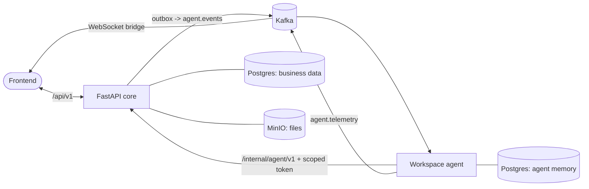

# Document processing platform with an autonomous workspace agent

Organizations create **templates** (each template is a workspace). Documents uploaded to a
workspace are turned into structured records by an autonomous agent that knows the workspace's
business: its template, the people and things that appear on its documents, past records, and
what humans have taught it.

```
site/               Next.js: landing page, onboarding, invitations (sign-in itself is Keycloak's)
www/                Next.js: the Syruss app
server/             FastAPI core: business data, rules, authority, human-facing API, Agent Tool API
agentic_framework/  autonomous workspace agent (separate service, see its README)
bridge/             docker-compose (Postgres, MinIO, Kafka), test dataset, live end-to-end script
```

## How the pieces talk



- **Template tenancy is real.** Every workspace request names its template (`X-Template-ID`),
  and every agent event carries a token valid for that one workspace.
- **Keycloak proves who you are; the database decides what you may do** (see "Sign-in and access"
  below). Two gates guard every workspace request: an organization membership, then a workspace
  membership whose role grants the permission the route needs.
- **Events are never lost.** Business changes and the event that wakes the agent are committed in
  one transaction (outbox); a relay publishes them to Kafka.
- **The agent decides, the core enforces.** Records must satisfy the active template version
  (`server/app/services/rule_engine.py`); template changes and entity merges need human approval.

## Sign-in and access

```
Browser ─► site (landing, onboarding, invitations) ─┐  each app is an OIDC client of Keycloak and keeps
Browser ─► www  (the Syruss app)                    ─┴► the tokens on its server (encrypted httpOnly cookie)
                  │  Bearer token, added server-side by www's /api/v1 proxy
                  ▼
             server  ─ verifies the token ─► organization gate ─► workspace gate ─► route permission
                  │  EdDSA-signed per-event token (the agent can verify, never mint)
                  ▼
             agentic_framework
```

- **Keycloak** (`bridge/keycloak`) holds passwords, Google sign-in, two-step verification and sessions.
  Tokens carry identity only: no organization or role claims, so changes take effect on the next request.
- **Organizations**: roles owner, admin, member run the organization (people, workspaces, billing). They do
  not open a workspace's documents: an admin joins a workspace with a role, and that is audited.
- **Workspaces**: five built-in roles plus custom ones a workspace defines, each a set of permissions
  from a closed catalogue (`server/app/core/permissions.py`). A role is a job title; the roles screen
  shows every privilege as a tick.
- **Chats are private** to the person who has them. Their live events go only to their own channel, and in a
  chat the agent can do only what that person's role allows (checked on every tool call).
- **Live updates** stream over Server-Sent Events (`GET /live/{channel}`) through the app's own proxy, and the
  API re-checks who may listen every minute while a stream is open.
- **Notifications** are one module (`server/app/services/notifications`). Each kind of message is declared once in
  `kinds.py` (its variables, an email template and/or an in-app notification) and sent with one call:
  `await notify(INVITATION, Recipient(email=..., user_id=...), {...})`. Email files live in
  `notifications/templates/email` (`<name>.html` and `<name>.txt` over a shared layout, Jinja, values escaped).
  A channel the person can't use is skipped (no account, no bell) and the returned `Delivery` says what happened.
  To add one: declare a kind, add its template files, call `notify`; a test fails if the files are missing.
  Invitations reach the invited person's email and, when they already have an account, their bell, whichever
  organization they are in. Mail goes through SMTP (`server/.env`: Gmail needs an App Password); locally Mailpit
  (`docker compose up mailpit` in `bridge/`, inbox at http://localhost:8025) catches every message.
- There is no development shortcut: every request carries a Keycloak token (`bridge/keycloak/README.md`).
  An account (email and password, or Google) lives in Keycloak; the profile and the organization are made
  on the site right after sign-up. Tests install their own identity source (`server/tests/mock_iam.py`).

## Business flow

1. An admin uploads sample documents. The agent proposes a template (objects, typed fields,
   rules) and asks about anything unclear. The admin accepts or edits it, which creates version 1.0.0.
2. Documents are uploaded and processed. For each one, the agent reads the page, recognizes
   entities using what it knows, and then either commits the record, sends it to review, parks it
   with a question, or fails it with a reason.
3. Humans answer questions, review records, and approve proposals. Each of these wakes the agent,
   which updates its lessons, aliases and entities and resumes any parked work.
4. When the agent sees information the template can't hold (for example a signed block or a
   recurring mark), it records the observation. When the pattern matters, it asks about it and
   proposes a new template version.

## Run locally

```bash
# 1. Start backing infrastructure (Postgres, MinIO, Kafka, Mailpit, Keycloak)
docker compose -f bridge/docker-compose.yml up -d

# 2. Install monorepo dependencies & register the syruss CLI (one-time setup)
pip install -r requirements.txt

# 3. Start all services in development mode (with live reload)
syruss run dev

# Or launch each service in its own console window to view isolated logs:
syruss run dev --console

# Or run individual services:
syruss run dev server    # FastAPI REST API (port 8000)
syruss run dev agent     # Autonomous AI agent worker
syruss run dev www       # Main workspace web application (port 3000)
syruss run dev site      # Landing, onboarding, and invitations portal (port 3100)
```

## Tests

```bash
cd server && python -m pytest             # core contract, rules, scoping (no Kafka/LLM needed)
cd agentic_framework && python -m pytest  # agent loop, tools, runtime guarantees (scripted model)
cd site && npm test && npm run check:auth-sync   # the landing page's live demo; the shared sign-in code
python bridge/e2e_live.py                 # live run against running services and a real model
```

Tests use separate databases (`doc_intelligence_test`, `agent_memory_test`).

## Schema changes

Tables are created at startup with `create_all`, which does not alter existing tables. After
this redesign, reset the development database (`POST /api/v1/admin/reset` truncates; to pick up
new columns, drop and recreate the `doc_intelligence` database). Adding Alembic migrations is
the next step before production data exists.
