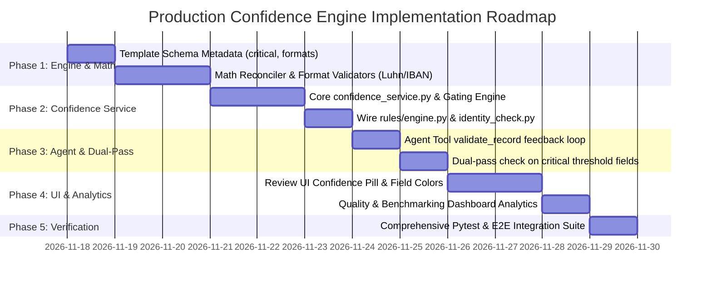

# Master Implementation Plan: Production-Grade Document Extraction Confidence Engine

> **Version:** 2.0 (Complete Exhaustive Specification)  
> **Status:** Approved Architecture — Ready for Phase 1 Execution  
> **Core Guarantee:** All weights are fixed (never shifting), enabling uncompromised benchmarking, transparent user incentives, and auditable enterprise gatekeeping.

---

## 1. Executive Vision & Problem Statement

### The Problem Today
* In the current system, document extraction confidence is **purely an LLM self-assessment** (a single float output from Gemini/multimodal models).
* LLMs have a known **hallucination blindspot**: a model will hallucinate a date or number and assign it `0.95` confidence without knowing it was wrong.
* The Rules Engine ([`server/app/services/rules/`](file:///c:/Users/sadee/OneDrive/Documents/document-processing-agentic-system/server/app/services/rules)) and Data Sources ([`server/app/services/source_service.py`](file:///c:/Users/sadee/OneDrive/Documents/document-processing-agentic-system/server/app/services/source_service.py)) are **completely disconnected** from the confidence number. If an invoice has incorrect math or names an unknown employee, the confidence score still shows whatever the LLM guessed.

### The Production Solution
Replace subjective self-reporting with an **audited, deterministic, 4-dimension composite scoring engine** where:
1. Every score is backed by objective proofs (visual clarity, mathematical reconciliation, rule evaluations, and master data matches).
2. Weights are **permanently constant** (never shift), giving admins an accurate benchmark of baseline visual performance vs. business verification.
3. Strict **Hard-Cap Vetoes** guarantee that catastrophic errors (math discrepancies, corrupt critical fields, identity collisions) **can never auto-commit**.

---

## 2. The Fixed 100-Point Scoring Model (Never Shifts)

Every document in every workspace is scored on the exact same **100-point scale**:

$$\text{Final Confidence} = S_{\text{visual}} + S_{\text{math\_format}} + S_{\text{rules}} + S_{\text{data\_sources}}$$

```
┌────────────────────────────────────────────────────────────────────────────────────────┐
│ TOTAL POSSIBLE SCORE: 100 POINTS (1.00)                                                │
├──────────────────────────┬──────────────────────────┬──────────────────────────────────┤
│ Dimension                │ Fixed Max Points         │ Evaluation Criteria              │
├──────────────────────────┼──────────────────────────┼──────────────────────────────────┤
│ 1. Visual & Field        │ 40 Points (0.40)         │ • Raw image legibility (typed vs │
│    Integrity             │                          │   handwriting vs degraded)       │
│                          │                          │ • Critical fields presence       │
│                          │                          │ • Dual-pass cross-check match    │
├──────────────────────────┼──────────────────────────┼──────────────────────────────────┤
│ 2. Formats &             │ 20 Points (0.20)         │ • Standard checksums (IBAN, Luhn)│
│    Arithmetic Reconciler │                          │ • ISO-8601 date validity         │
│                          │                          │ • Line totals == subtotal == sum │
│                          │                          │ • Time difference == duration    │
├──────────────────────────┼──────────────────────────┼──────────────────────────────────┤
│ 3. Workspace Rules       │ 20 Points (0.20)         │ • Evaluated by rules/engine.py   │
│    (lang.py)             │                          │ • N_passed / N_active_rules      │
│                          │                          │ • 0 pts if no rules configured   │
├──────────────────────────┼──────────────────────────┼──────────────────────────────────┤
│ 4. Master Data Sources   │ 20 Points (0.20)         │ • Matched against CSV / ERP API  │
│    (Knowledge Graph)     │                          │ • Entity & Alias corroboration   │
│                          │                          │ • 0 pts if no source connected   │
└──────────────────────────┴──────────────────────────┴──────────────────────────────────┘
```

### Why Weights Do Not Shift:
* **Maturity Stage 1 (Raw Upload):** No rules, no data sources $\to$ Max possible score is **$40 + 20 = 60\%$**. The document goes to review because visual reading alone cannot guarantee business truth.
* **Maturity Stage 2 (Rules Added):** User adds arithmetic and format rules $\to$ Max possible score reaches **$80\%$**.
* **Maturity Stage 3 (Enterprise Master Data Connected):** User imports vendor/roster CSV or connects ERP API $\to$ Score reaches **$95–100\%$**, safely unlocking high-volume **Auto-Commit**.

---

## 3. The Hard-Cap Vetoes (Zero Hallucination Tolerance)

Even if a document scores 78 points across other dimensions, any of the following catastrophic conditions forces an **immediate hard cap to $\le 0.50$**, refusing auto-commit:

$$\text{Final Confidence} = \min(0.50, \text{Calculated Score}) \quad \text{if any veto condition is true}$$

### Veto Conditions:
1. **Mathematical Contradiction:**  
   If detected line items, subtotals, taxes, and grand totals fail arithmetic reconciliation by more than a \$0.02 tolerance (e.g. $10.00 + 5.00 = 20.00$).
2. **Master Identity Collision:**  
   If an extracted identifier belongs to Entity A in the uploaded Data Source master list, but the document names Entity B (detected by [`identity_check.py`](file:///c:/Users/sadee/OneDrive/Documents/document-processing-agentic-system/server/app/services/identity_check.py)).
3. **Critical Field Missing or Broken:**  
   If any field tagged `critical: true` in the template schema (e.g. `invoice_total`, `employee_id`, `record_date`) is empty or fails its regex/type check.
4. **Blocking Workspace Rule Violation:**  
   If any active workspace rule with `severity: "error"` evaluates to false.

---

## 4. Architectural Component Breakdown

### Component 1: Schema Definition Extensions
* **File:** [`server/app/schemas/template.py`](file:///c:/Users/sadee/OneDrive/Documents/document-processing-agentic-system/server/app/schemas/template.py)
* Add field-level metadata to schema definitions:
  * `critical: bool` (default `false`) — Identifies non-negotiable business fields.
  * `format_rule: Optional[str]` — Validates standard formats:
    * `"currency"`: Standard currency string / float.
    * `"iso_date"`: Valid YYYY-MM-DD.
    * `"iban"`: International Bank Account Number with Modulo-97 checksum.
    * `"luhn"`: Credit card / national ID checksum.
    * `"email"`: Standard RFC-5322 format.
    * `"regex:<pattern>"`: Custom RE2 pattern.
  * `math_role: Optional[str]` — `"line_total"`, `"subtotal"`, `"tax"`, `"grand_total"`, `"hours"`.

### Component 2: Intrinsic Format & Arithmetic Validators
* **Directory:** `server/app/services/validation/`
* **`formatters.py`:**
  - Standalone, zero-dependency validators for Luhn, Modulo-97, ISO dates, and RE2 regexes.
* **`math_reconciler.py`:**
  - Automatically identifies arithmetic roles in records.
  - Runs 3 standard checks:
    1. Line Item Sum: $\left|\sum(\text{line\_total}) - \text{subtotal}\right| \le 0.02$
    2. Tax Reconciliation: $\left|\text{subtotal} + \text{tax} - \text{grand\_total}\right| \le 0.02$
    3. Shift Duration: $\left|(\text{end\_time} - \text{start\_time}) - \text{hours}\right| \le 0.05$

### Component 3: Dual-Pass / Multi-Sample Verification
* **File:** `agentic_framework/agent/loop.py` & `worker.py`
* When an extraction has critical fields near the threshold boundary ($0.75 \le \text{confidence} \le 0.85$):
  - The agent performs a targeted second-pass reading of the critical fields.
  - If Pass 1 and Pass 2 values match identically $\to$ Awards full dual-pass points ($+5$ pts).
  - If values differ $\to$ $0$ pts and flags the field for human inspection.

### Component 4: Rules Engine Integration
* **Files:** [`server/app/services/rules/engine.py`](file:///c:/Users/sadee/OneDrive/Documents/document-processing-agentic-system/server/app/services/rules/engine.py), [`rules/lang.py`](file:///c:/Users/sadee/OneDrive/Documents/document-processing-agentic-system/server/app/services/rules/lang.py)
* Connects `validate_record` outputs directly to confidence calculation:
  - If no rules are configured in the workspace $\to S_{\text{rules}} = 0.0$ (0 / 20 pts).
  - If active rules exist:
    $$S_{\text{rules}} = 20 \times \frac{N_{\text{passed}}}{N_{\text{total\_active\_rules}}}$$
  - A failed `"warning"` rule deducts partial points.
  - A failed `"error"` rule deducts all 20 points **AND triggers the $\le 0.50$ Hard-Cap Veto**.

### Component 5: Data Sources & Knowledge Graph Integration
* **Files:** [`server/app/services/source_service.py`](file:///c:/Users/sadee/OneDrive/Documents/document-processing-agentic-system/server/app/services/source_service.py), [`server/app/services/identity_check.py`](file:///c:/Users/sadee/OneDrive/Documents/document-processing-agentic-system/server/app/services/identity_check.py)
* Evaluates extracted entities against authoritative CSV/API records:
  - If no Data Sources are connected $\to S_{\text{data\_sources}} = 0.0$ (0 / 20 pts).
  - If Data Sources exist:
    - **Exact Match:** Extracted ID and Name match an `Entity` imported from a data source $\to$ Full points (20 / 20 pts).
    - **Alias Match:** Extracted name matches an `EntityAlias` $\to$ 18 / 20 pts.
    - **Unknown Entity (Closed Source):** Extracted entity is not in master list $\to$ 5 / 20 pts.
    - **Identity Collision:** ID belongs to a different person/company in master data $\to$ 0 pts **AND triggers the $\le 0.50$ Hard-Cap Veto**.

### Component 6: The Unified Confidence Evaluator Service
* **File:** `server/app/services/confidence_service.py`
* Single authoritative service that takes:
  1. Extracted Record Data
  2. Template Schema Definition
  3. Active Workspace Rules
  4. Workspace Knowledge Entities
* Computes the 4-part score, applies hard-cap vetoes, and generates a structured audit breakdown:
  ```json
  {
    "total_confidence": 0.88,
    "hard_cap_applied": null,
    "breakdown": {
      "visual": {"score": 35.0, "max": 40.0, "legibility": "high"},
      "math_format": {"score": 18.0, "max": 20.0, "reconciliation": "verified"},
      "rules": {"score": 15.0, "max": 20.0, "passed": 3, "warnings": 1, "failed": 0},
      "data_sources": {"score": 20.0, "max": 20.0, "matched_entities": 4, "unknown": 0}
    },
    "field_confidences": {
      "Invoice.total": 1.0,
      "Invoice.vendor_name": 0.95
    }
  }
  ```

### Component 7: Agent Feedback & Self-Correction
* **File:** [`agentic_framework/agent/tools/records.py`](file:///c:/Users/sadee/OneDrive/Documents/document-processing-agentic-system/agentic_framework/agent/tools/records.py)
* When the agent calls `validate_record`, the tool returns the complete confidence breakdown.
* If a math mismatch occurred, the agent receives:
  `"Math Discrepancy: items sum to 120.00, stated total is 100.00. Score capped at 0.50."`
* The agent re-checks the image pixels, fixes the misread line item, and re-validates before calling `submit_record`.

### Component 8: Review Screen UI & Benchmark Analytics
* **Frontend Review Screen:** [`www/src/app/[org]/w/[ws]/review/`](file:///c:/Users/sadee/OneDrive/Documents/document-processing-agentic-system/www/src/app/[org]/w/[ws]/review/)
  - **Interactive Score Pill:** Clicking the confidence badge opens a detailed scorecard showing:
    - 👁️ Visual Reading: `35 / 40`
    - 📐 Math & Formats: `20 / 20`
    - 📋 Business Rules: `0 / 20` *(Info: "Add rules under Template → Rules to raise confidence")*
    - 🗄️ Master Data: `0 / 20` *(Info: "Connect data sources under Knowledge → Sources")*
  - **Field Color Coding:**
    - 🟢 Green ($\ge 90\%$): Verified by math, format, or master data.
    - 🟡 Amber ($70–89\%$): Visual reading only, uncorroborated.
    - 🔴 Red ($< 70\%$): Discrepancy, format violation, or missing critical field.
* **Analytics Dashboard:** [`server/app/services/quality_service.py`](file:///c:/Users/sadee/OneDrive/Documents/document-processing-agentic-system/server/app/services/quality_service.py)
  - Benchmarks workspace accuracy trends:
    - Baseline visual reading accuracy vs human corrections.
    - Rate of auto-commits unlocked by adding rules.
    - Rate of auto-commits unlocked by connecting data sources.

---

## 5. Phased Implementation Roadmap



---

## 6. Acceptance & Verification Criteria

1. **Fixed Weights Integrity:** The maximum possible score without rules and without data sources is mathematically capped at $60\%$. Adding rules contributes up to $+20\%$; adding data sources contributes up to $+20\%$.
2. **Deterministic Veto:** An invoice where line items do not sum to total **cannot** exceed $0.50$ confidence under any circumstances.
3. **Identity Protection:** A document with an ID that collides with a different entity in the master data source **cannot** exceed $0.50$ confidence.
4. **Agent Correction:** The agent detects math mismatches from `validate_record` and corrects readings before `submit_record`.
5. **Transparency:** Every `ExtractionResult` persists the full 4-part scorecard in `validation.confidence_details`.
